## HI, I'M MEL 👾

> "Existe uma teoria que diz que, se algum dia alguém descobrir exatamente para que serve o Universo e por que ele está aqui, ele desaparecerá instantaneamente e será substituído por algo ainda mais estranho e inexplicável. Existe uma segunda teoria que diz que isso já aconteceu." - Douglas Adams

✨ Ciência da Computação, Dados e QA ✨

---

### ☁️ Sobre mim

```python
class Mel:
    cargo       = "Software QA Engineer e Cientista da Computação"
    nivel       = "Pleno | 4+ anos em tecnologia"
    formacao    = ["Ciência de Dados", "QA", "Analista de Automação", 'Desenvolvimento de Software']
    interesses  = ["Astronomia", "Matemática", "Bioinformática", "Ciência no geral", "História", "Computação"]
    superpoder  = "Transformar dados confusos em algo que faz sentido 🔍"

    def missao(self):
        return "Mestrado em Computação Aplicada a Astronomia"
```

Sou Software QA Engineer trabalhando com automação de testes, IA e cloud, formada em Ciência de Dados pelo Mackenzie e buscando crescer na área da computação científica. Sou autodidata, adoro ler sobre astronomia, ciência e história. 👩🏽‍💻

---



